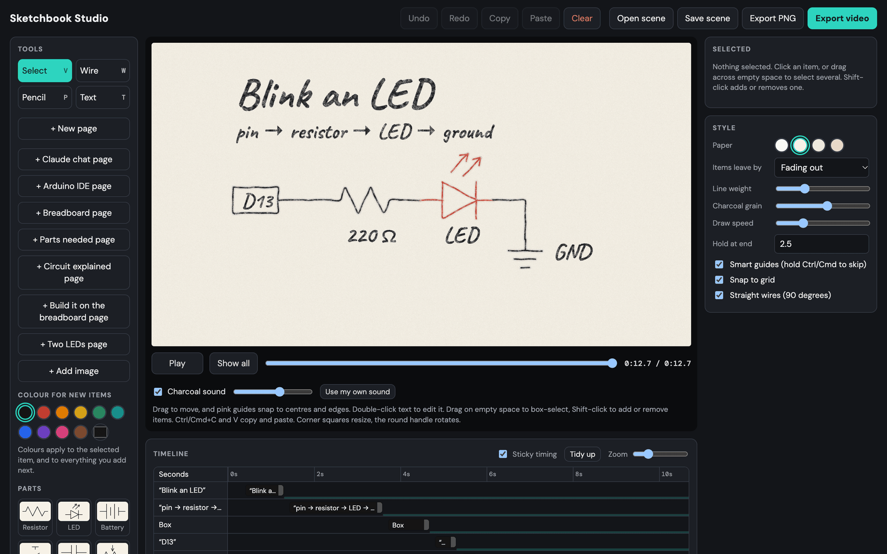
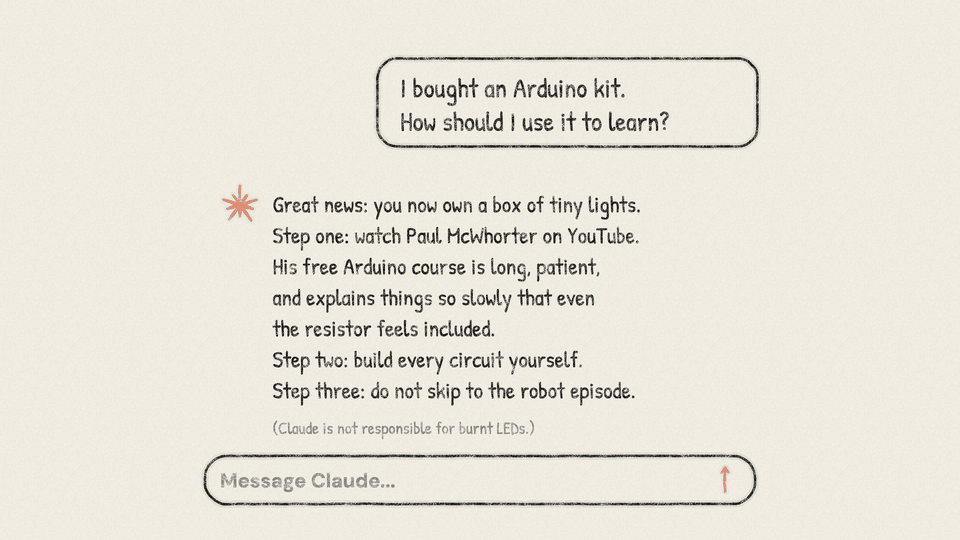
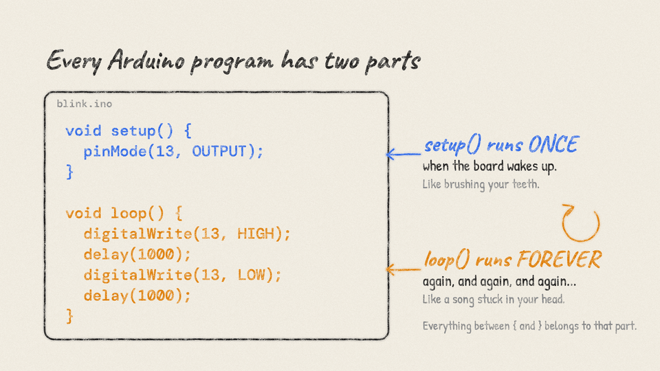
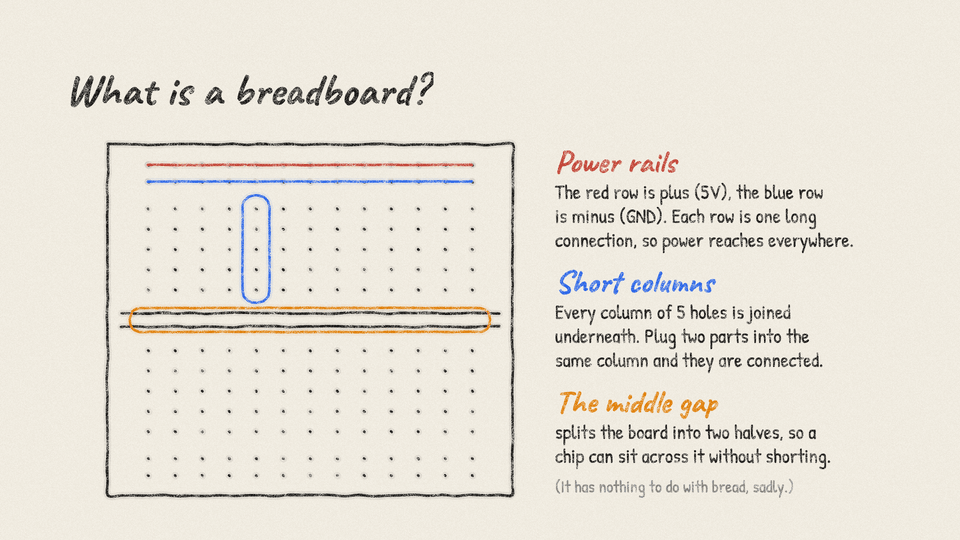
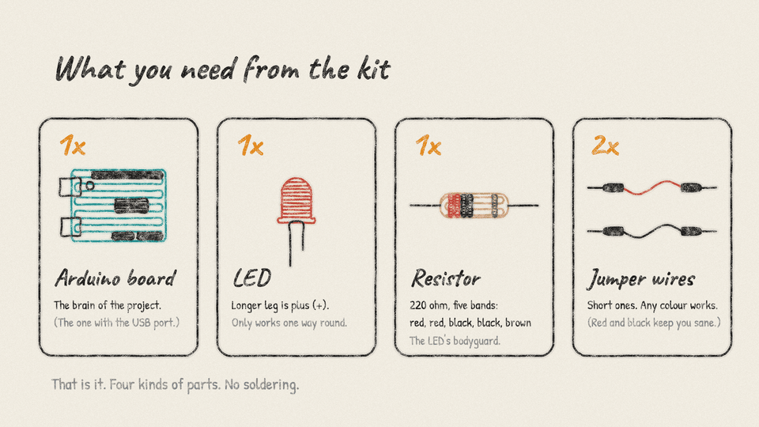
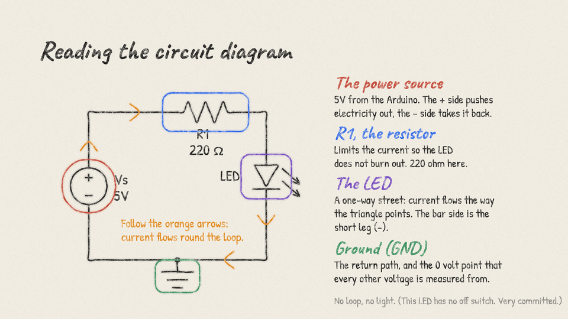
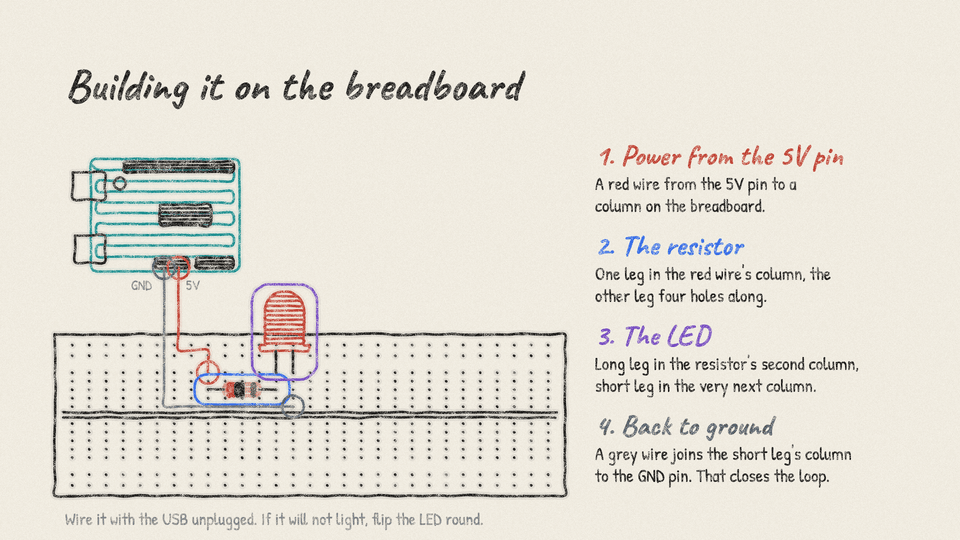
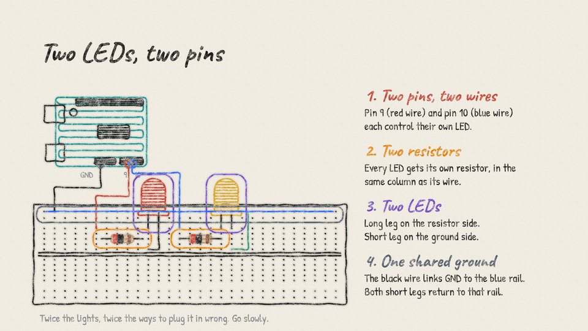
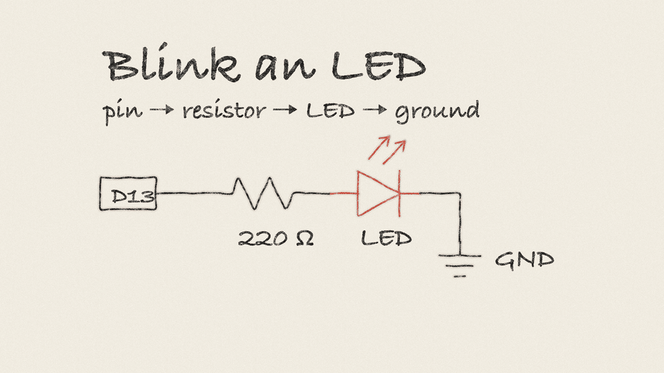

# Sketchbook Studio

A visual editor for making "sketchbook" explainer cuts for videos: off-white paper, charcoal-style hand-drawn lines that draw themselves, handwriting text and a chalk sound. Made for an Arduino-learning video series.

<p align="center">
  
</p>

Single file, no build step, no dependencies. Open `index.html` in a browser, or try it at **https://zahra-hasan.github.io/sketchbook-studio/**.



## Features
- Draw parts (resistor, LED, Arduino, breadboard...), wires, freehand lines, text and images on a 1920x1080 board
- Scale, rotate, multi-select, copy/paste, smart guides
- Timeline with sticky "follows previous" timing, overlaps, page breaks and per-item lifetimes
- Per-item colours and fonts, text editing on the board
- Ready-made pages: Claude chat, Arduino IDE, breadboard, parts, circuit, build, two LEDs
- Chalk sound, export to PNG, scene JSON and MP4/WebM video

## Ready-made pages

One click adds a finished page to the timeline. Every line, word and part draws itself in order when you press Play, and you can double-click any text to rewrite it.

| | |
|:---:|:---:|
| <br>**Claude chat** | <br>**Arduino IDE** |
| <br>**Breadboard** | <br>**Parts needed** |
| <br>**Circuit explained** | <br>**Build it on the breadboard** |
| <br>**Two LEDs** | <br>**The starting scene** |

## Claude skill
`skill/sketchbook-video` teaches Claude to start a new video in this style. Copy it to `~/.claude/skills/` to use it in Claude Code.

```bash
cp -R skill/sketchbook-video ~/.claude/skills/
```

## License
MIT, see [LICENSE](LICENSE).
